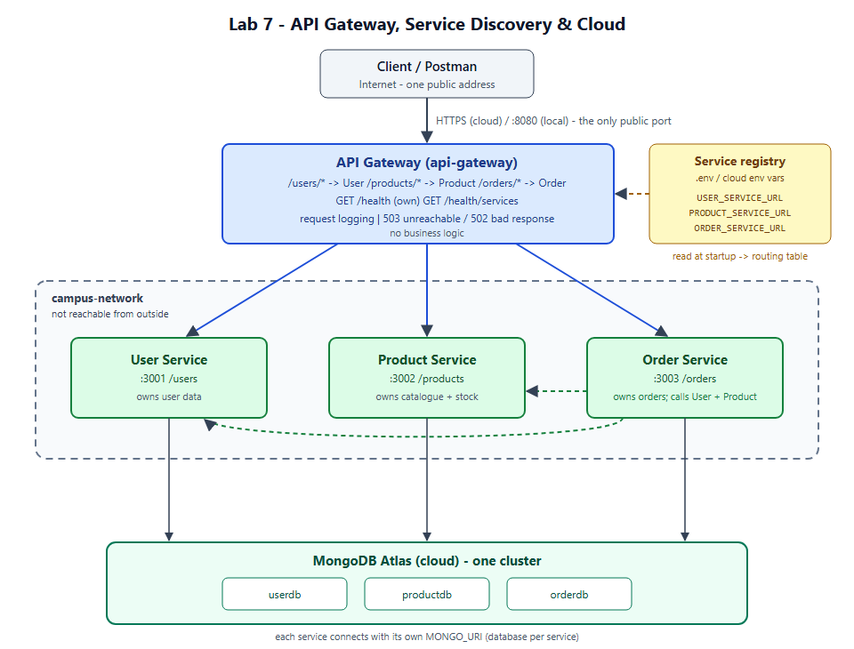
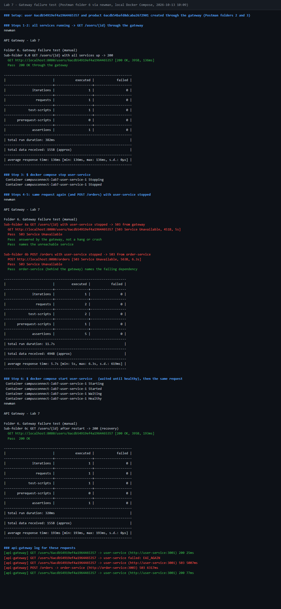

# Lab 7 — API Gateway, Service Discovery & Cloud Deployment

**Sumit Goyal** · Roll No. 202512092
Web Services & SOA Laboratory

---

## 1. Overview and relation to Lab 6

Lab 6 split the backend into three services (User, Product and Order). Postman
called each one directly on its own port (3001, 3002, 3003). Lab 7 adds three
things:

| Part | What was added |
| ---- | -------------- |
| A. API Gateway | New `api-gateway` service (Express + `http-proxy-middleware`). It is the **only** entry point: it routes `/users`, `/products` and `/orders`, logs every request, answers CORS for browser clients, and returns a clean `503`/`502` when a service is down. |
| B. Service discovery | The gateway reads service locations from environment variables (`USER_SERVICE_URL`, `PRODUCT_SERVICE_URL`, `ORDER_SERVICE_URL`). The route code contains no URLs. |
| C. Cloud | A `render.yaml` Blueprint deploys all four containers to Render. The databases moved from local Mongo containers to **MongoDB Atlas** (one database per service). |

**The microservices themselves were not changed.** `server.js`, the models,
`db.js` and the Dockerfiles are byte-for-byte the same as Lab 6 (`diff -r`
shows only the `.env.example` files differ). The resources, endpoints and
status codes are the same. Only these changed around them:

| Change | Why |
| ------ | --- |
| Services use `expose` instead of `ports` in `compose.yaml` | Only the gateway is reachable from outside |
| `user-db`, `product-db`, `order-db` containers removed | Data is in Atlas (`userdb`, `productdb`, `orderdb`) through each service's `MONGO_URI` |
| One shared registry in `.env` | The gateway and Order Service read the same `*_SERVICE_URL` values |

---

## 2. Architecture



Source: [`docs/architecture.svg`](docs/architecture.svg)

```
                     Client / Postman  (internet)
                               │  one public address
                               ▼
     ┌─────────────────────────────────────────────┐      ┌──────────────────────┐
     │ API Gateway   :8080 (local) / https (cloud) │◄─────│ Service registry     │
     │ routing · logging · 502/503 · GET /health   │ read │ USER_SERVICE_URL     │
     └──────────┬──────────────┬──────────────┬────┘ at   │ PRODUCT_SERVICE_URL  │
                │              │              │   start  │ ORDER_SERVICE_URL    │
  ┌ ─ ─ ─ ─ ─ ─ ┼ ─ ─ ─ ─ ─ ─ ─┼─ ─ ─ ─ ─ ─ ─ ┼ ─ ─ ─ ┐  └──────────────────────┘
    campus-network (Docker) - not reachable from outside
  │  ┌──────────▼───┐  ┌───────▼──────┐  ┌────▼─────────┐  │
     │ User Service │  │Product Serv. │  │ Order Service│     Order calls User and
  │  │ :3001 /users │  │:3002/products│  │ :3003 /orders│  │  Product over REST
     └──────┬───────┘  └──────┬───────┘  └──────┬───────┘
  └ ─ ─ ─ ─ ┼ ─ ─ ─ ─ ─ ─ ─ ─ ┼ ─ ─ ─ ─ ─ ─ ─ ─ ┼ ─ ─ ─ ┘
            ▼                 ▼                 ▼
     ┌────────────────────────────────────────────────┐
     │ MongoDB Atlas:  userdb · productdb · orderdb    │
     └────────────────────────────────────────────────┘
```

| Layer | Responsibility | Reachable from |
| ----- | -------------- | -------------- |
| Client / Postman | Sends requests to one address | Internet |
| API Gateway | Routes `/users`, `/products`, `/orders`; logging; error handling | Internet (public) |
| User / Product / Order Service | Business logic and own data | Docker network only (see the cloud limitation in 8.5) |
| MongoDB Atlas | Storage, one database per service | Services, through their connection string |

### Local vs cloud architecture

| Layer | Local (Docker Compose) | Cloud (Render) |
| ----- | ---------------------- | -------------- |
| Entry | Postman / React on the same machine | Any internet client |
| Gateway | `api-gateway` container, `http://localhost:8080` | Public gateway, `https://lab7-api-gateway.onrender.com` |
| Network | Docker network `campus-network` | Platform network (see the limitation in 8.5) |
| Services | Reached by service name, `http://user-service:3001` | Reached by platform URL, `https://lab7-user-service.onrender.com` |
| Database | MongoDB Atlas | MongoDB Atlas (same cluster) |

**What stays the same:** application code, routes, API contract and the
Docker images. **What changes:** where it runs, the values in the service
registry, and the gateway becoming public.

### Folder layout

```
lab7/
├── README.md
├── compose.yaml                   gateway + 3 services; only the gateway publishes a port
├── .env.example                   service registry, ports, Atlas URIs (copy to .env)
├── render.yaml                    Render Blueprint for the cloud deployment
├── api-gateway/                   NEW
│   ├── config.js                  service registry: reads and validates *_SERVICE_URL
│   ├── server.js                  routing, logging, /health, 502/503 handling
│   ├── Dockerfile  .dockerignore  .env.example
│   └── package.json  package-lock.json
├── user-service/                  unchanged from Lab 6
├── product-service/               unchanged from Lab 6
├── order-service/                 unchanged from Lab 6
├── docs/architecture.svg
├── postman/
│   ├── API-Gateway-Lab7.postman_collection.json
│   ├── Lab7-Local.postman_environment.json     baseUrl = http://localhost:8080
│   └── Lab7-Cloud.postman_environment.json     baseUrl = public gateway URL
└── screenshots/
    └── logs/                      raw terminal output for each check
```

---

## 3. Part A — The API Gateway

### Routing table

| Gateway path | Routed to | Registry variable |
| ------------ | --------- | ----------------- |
| `/users`, `/users/*` | User Service | `USER_SERVICE_URL` |
| `/products`, `/products/*` | Product Service | `PRODUCT_SERVICE_URL` |
| `/orders`, `/orders/*` | Order Service | `ORDER_SERVICE_URL` |
| `GET /health` | Gateway itself, not proxied | — |
| `GET /health/services` | Gateway calls each service's `/health` | — |
| anything else | `404` from the gateway | — |

The path is forwarded **unchanged**, so `GET /users/101` on the gateway becomes
`GET /users/101` on User Service. All methods (GET, POST, PUT, DELETE) and the
request body pass through as they are. The gateway never parses the body. It
contains no business logic.

`/users` matches `/users` and `/users/...` but not `/usersX`.

### Health check

```
GET /health  ->  200
{"status":"ok","service":"api-gateway","uptimeSeconds":70,
 "routes":[{"prefix":"/users","service":"user-service"}, ...]}
```

`GET /health/services` asks every registered service for its own `/health`.
It returns `200` when all of them answer, and `503` when any is down. This is
a quick way to check that the registry points at live services.

### Request logging

Each request produces one line with method, path, target service, status and time taken:

```
[api-gateway] GET /users -> user-service (http://user-service:3001) 200 78ms
[api-gateway] POST /orders -> order-service (http://order-service:3003) 201 465ms
[api-gateway] GET /health -> api-gateway 200 1ms
[api-gateway] GET /users -> user-service failed: EAI_AGAIN
[api-gateway] GET /users -> user-service (http://user-service:3001) 503 5008ms
```

### Centralized error handling

When a proxy call fails, one error handler in `server.js` answers. The gateway
never hangs or crashes:

| Situation | Status | Example `reason` |
| --------- | ------ | ---------------- |
| Service container stopped (name no longer resolves) | `503 Service Unavailable` | `EAI_AGAIN`, `ENOTFOUND` |
| Wrong port / nothing listening | `503 Service Unavailable` | `ECONNREFUSED` |
| Service does not answer within `PROXY_TIMEOUT_MS` | `503 Service Unavailable` | `ECONNRESET` |
| Any other proxy failure | `502 Bad Gateway` | the error code |

```json
{"status":503,"service":"api-gateway","error":"Service Unavailable",
 "message":"user-service is not reachable right now, please try again later",
 "target":"user-service","reason":"EAI_AGAIN"}
```

The response names the service but not its internal URL. The URL appears only
in the gateway log, so clients do not learn the internal layout.

When a service *answers* with an error (`404`, `400`, `409`, Order Service's
own `503`), the gateway passes it through unchanged. That keeps the Lab 6
status codes the same.

The gateway also checks its configuration at startup. If a `*_SERVICE_URL` is
missing or invalid, it stops with a clear message instead of starting half-configured:

```
api-gateway configuration error: ORDER_SERVICE_URL is not set
```

### Only the gateway is exposed

In `compose.yaml` only `api-gateway` has `ports:`. The three services only have
`expose:`, so they are reachable from other containers on `campus-network` and
nowhere else. Checked in [`logs/02-only-gateway-exposed.txt`](screenshots/logs/02-only-gateway-exposed.txt):

```
api-gateway       0.0.0.0:8080->8080/tcp
order-service     3003/tcp
product-service   3002/tcp
user-service      3001/tcp

$ curl http://localhost:3001/health
curl: failed to connect (exit 7) - port 3001 is not published
```

### CORS

A browser (React) client only ever talks to the gateway's origin, so CORS is
answered at the gateway with `app.use(cors())`, the same `cors` package the
services already use. Preflight `OPTIONS` requests are answered by the gateway
and never proxied:

```
$ curl -i -X OPTIONS http://localhost:8080/users -H "Origin: http://localhost:5173" -H "Access-Control-Request-Method: POST"
HTTP/1.1 204 No Content
Access-Control-Allow-Origin: *
Access-Control-Allow-Methods: GET,HEAD,PUT,PATCH,POST,DELETE
```

Postman and `curl` do not need CORS. It only matters for browser clients.

### Discussion: why an API Gateway instead of calling each service directly?

- **One entry point.** Clients know one address (`https://…/`) instead of one
  host and port per service. In Lab 6, Postman needed three base URLs; now it
  needs one.
- **Internal structure stays hidden.** Clients don't know how many services
  there are, where they run, or which port they use. Services can be split,
  merged, moved or scaled without breaking clients, because only the gateway's
  routing table changes.
- **Less exposure.** Only the gateway is on the internet. The services sit on
  the private network, so there are fewer things to secure.
- **Cross-cutting concerns in one place.** Logging, error responses and
  timeouts are written once in the gateway instead of copied into every
  service. Authentication, rate limiting, CORS and HTTPS would go here later
  for the same reason.
- **Consistent failures.** A dead service gives the client a clear `503` JSON
  response instead of a connection error or a request that hangs.

The cost is an extra hop and one more component to run. The gateway can become
a single point of failure, which is why it is kept small and free of business logic.

---

## 4. Part B — Service discovery (configuration-based)

### The registry

The service registry is a set of environment variables, kept in `.env` locally
and in the platform's environment settings in the cloud:

```ini
USER_SERVICE_URL=http://user-service:3001
PRODUCT_SERVICE_URL=http://product-service:3002
ORDER_SERVICE_URL=http://order-service:3003
```

`api-gateway/config.js` reads these at startup, validates them (they must be
`http(s)` base URLs), and builds the routing table. The route definitions
reference the **variable names**, never the URLs:

```js
const ROUTES = [
  { prefix: '/users',    service: 'user-service',    urlVar: 'USER_SERVICE_URL' },
  { prefix: '/products', service: 'product-service', urlVar: 'PRODUCT_SERVICE_URL' },
  { prefix: '/orders',   service: 'order-service',   urlVar: 'ORDER_SERVICE_URL' }
];
```

At startup the gateway prints the table it built:

```
api-gateway listening on port 8080
  /users/* -> user-service at http://user-service:3001 (from USER_SERVICE_URL)
  /products/* -> product-service at http://product-service:3002 (from PRODUCT_SERVICE_URL)
  /orders/* -> order-service at http://order-service:3003 (from ORDER_SERVICE_URL)
```

Order Service reads the same `USER_SERVICE_URL` and `PRODUCT_SERVICE_URL`, so
there is one registry for the whole system.

### Proof: moving a service with configuration only

User Service was moved from port 3001 to **4001** by changing only two values
in the environment. No file under `api-gateway/` or `user-service/` was edited.
Full output: [`logs/04-config-change-no-code.txt`](screenshots/logs/04-config-change-no-code.txt).

```
$ USER_SERVICE_PORT=4001 USER_SERVICE_URL=http://user-service:4001 docker compose up -d

api-gateway listening on port 8080
  /users/* -> user-service at http://user-service:4001 (from USER_SERVICE_URL)
user-service listening on port 4001

$ curl http://localhost:8080/health/services
{"service":"user-service","reachable":true,"status":200,"health":{..."port":4001,"db":"connected"}}

$ curl -i http://localhost:8080/users
HTTP/1.1 200 OK
[api-gateway] GET /users -> user-service (http://user-service:4001) 200 121ms
```

The reverse check proves the gateway really follows the registry. With the
service on 4001 but the registry still saying 3001, the gateway cannot reach it:

```
{"status":503,"service":"api-gateway","error":"Service Unavailable",
 "message":"user-service is not reachable right now, please try again later","reason":"ECONNREFUSED"}
```

To do the same by editing `.env`, set `USER_SERVICE_PORT=4001` and
`USER_SERVICE_URL=http://user-service:4001`, then run `docker compose up -d`.

### Local vs cloud service URLs

In Lab 6, containers reached each other by Docker service name. In the cloud
the addressing is different, but only the registry **values** change:

| Environment | `USER_SERVICE_URL` example |
| ----------- | -------------------------- |
| Local Docker Compose | `http://user-service:3001` |
| Cloud internal service | Platform-provided internal hostname, e.g. `http://lab7-user-service:10000` (Render private service, paid) |
| Cloud public service (used here, see 8.5) | `https://lab7-user-service.onrender.com` |
| Public API (what clients use) | `https://lab7-api-gateway.onrender.com` |

The same image runs locally and in the cloud. Only the environment variables
differ.

### Discussion: static config vs dynamic service discovery

With this static approach, the list of locations is written down before
startup and read **once**. Docker's DNS or the cloud platform turns the name
into an address, but the name and port are fixed until someone edits the
config and restarts.

A dynamic registry (Consul, Eureka, Kubernetes Services/DNS) adds what a static file cannot:

| Dynamic registry | Static config file |
| ---------------- | ------------------ |
| Services **register themselves** when they start and are removed when they stop | Someone has to edit the file |
| **Health checks** built in: unhealthy instances are taken out of rotation automatically | The gateway keeps sending traffic to a dead address and returns 503 |
| **Many instances** per service, with client-side or server-side load balancing | One URL per service |
| Changes take effect **live**: clients watch the registry or re-query DNS | Changes need a restart or redeploy of the gateway |
| Works when addresses change often (autoscaling, rolling deploys, containers rescheduled to other hosts) | Fine only when locations rarely change |

For three services with fixed names, static config is simpler and enough.
There is nothing extra to run, and it is easy to reason about. It stops
scaling once instances come and go on their own. Then you need a registry
that tracks them, which means Consul/Eureka, or Kubernetes, where a Service
name always resolves to the currently healthy pods.

---

## 5. Running locally

Requirements: Docker Desktop and a MongoDB Atlas cluster.

```bash
cd lab7
cp .env.example .env        # then put your Atlas user/password/host into the three *_MONGO_URI lines
docker compose up -d --build
docker compose ps           # all four "healthy"; only api-gateway shows 0.0.0.0:8080
curl http://localhost:8080/health
curl http://localhost:8080/health/services
```

In Atlas, **Network Access** must allow your IP address, or `0.0.0.0/0` for
the cloud deployment.

If the Lab 6 stack is still running, stop it first (`cd ../lab6 && docker
compose stop`). Otherwise `localhost:3001-3003` still answer, but from Lab 6.

Stop: `docker compose down`. No volumes to delete, because the data is in Atlas.

---

## 6. Testing (Postman)

Import `postman/API-Gateway-Lab7.postman_collection.json` and both environment
files. Every request uses `{{baseUrl}}`, so the **same collection** runs
locally and in the cloud. Only the selected environment changes.

| Folder | What it checks |
| ------ | -------------- |
| 1. Gateway | `GET /health` (answered by the gateway), `GET /health/services`, unknown path → gateway `404` |
| 2. Users via gateway | GET list, POST (`201` + `Location`), GET by id, PUT, invalid id → `404` from user-service |
| 3. Products via gateway | GET list, POST, GET by id, PUT, invalid id → `404` from product-service |
| 4. Orders via gateway | POST order (gateway → Order → User + Product), GET list, GET by id, `?expand=true`, stock reduced, unknown user → `404` |
| 5. Deletes via gateway | DELETE user → `204` → GET → `404`; DELETE product → `204` |
| 6. Gateway failure test (manual) | 6.0 `GET /users/{id}` → `200`; 6a same request with user-service stopped → gateway `503`; 6b `POST /orders` → order-service `503`; 6c after restart → `200` |

The same run from the command line, which was used to produce the evidence logs:

```bash
npx newman run postman/API-Gateway-Lab7.postman_collection.json -e postman/Lab7-Local.postman_environment.json
```

Local result ([`logs/05-newman-local.txt`](screenshots/logs/05-newman-local.txt)):
**27 requests, 50 assertions, 0 failed.** (Recorded before request 6.0 was
added to folder 6. A run now shows 28 requests.)

### Gateway failure test (local)

Each step is a request in Postman folder 6:

| Step | Action | Expected |
| ---- | ------ | -------- |
| 1 | `docker compose up -d` (gateway, User, Product, Order) | all four healthy |
| 2 | 6.0 `GET /users/{id}` through the gateway | `200` |
| 3 | `docker compose stop user-service` | — |
| 4 | 6a same request again (and 6b `POST /orders`) | — |
| 5 | Check the response | `503` from `api-gateway` right away, `reason: EAI_AGAIN`. No hang, no crash. `/health` still `200`. |
| 6 | `docker compose start user-service`, then 6c | `200` again (recovery) |

```bash
docker compose stop user-service
curl -i http://localhost:8080/users/<id>      # 503 from api-gateway, reason EAI_AGAIN
docker compose start user-service
curl -i http://localhost:8080/users/<id>      # 200 again
```

Output: [`logs/06-unreachable-503.txt`](screenshots/logs/06-unreachable-503.txt) (curl).
The full 6-step run with Postman folder 6 (via newman) is in
[`logs/08-failure-test.txt`](screenshots/logs/08-failure-test.txt) and
[`07-postman-failure-test.png`](screenshots/07-postman-failure-test.png):
6.0 `200` → user-service stopped → 6a `503` from the gateway after 5 s (no
hang), 6b `503` from order-service → restarted → 6c `200`. 8 assertions, 0 failed.



The gateway itself kept answering `/health` with `200` the whole time. This is
the point of centralized error handling: one place turns "service is gone"
into a clear, fast `503` for every client.

---

## 7. Evidence

| Evidence | File |
| -------- | ---- |
| Resolved compose file (Atlas passwords masked) | [`logs/01-compose-config.txt`](screenshots/logs/01-compose-config.txt) |
| Only the gateway port is published | [`logs/02-only-gateway-exposed.txt`](screenshots/logs/02-only-gateway-exposed.txt) |
| Startup: services connect to Atlas, gateway prints its routing table | [`logs/03-compose-up-and-routing-table.txt`](screenshots/logs/03-compose-up-and-routing-table.txt) |
| Config-only change moves the route | [`logs/04-config-change-no-code.txt`](screenshots/logs/04-config-change-no-code.txt) |
| Full collection through the gateway, local | [`logs/05-newman-local.txt`](screenshots/logs/05-newman-local.txt) |
| Full collection against the public cloud URL | [`logs/07-newman-cloud.txt`](screenshots/logs/07-newman-cloud.txt) |
| 503 on stopped service + recovery | [`logs/06-unreachable-503.txt`](screenshots/logs/06-unreachable-503.txt) |
| Gateway failure test, Postman folder 6 (200 → 503 → 200) | [`logs/08-failure-test.txt`](screenshots/logs/08-failure-test.txt) · [`07-postman-failure-test.png`](screenshots/07-postman-failure-test.png) |
| Architecture diagram | [`02-architecture-diagram.png`](screenshots/02-architecture-diagram.png) |

Screenshots to add (Postman / Render dashboard):

| File | Shows |
| ---- | ----- |
| `screenshots/05-postman-local-run.png` | Collection Runner, "Lab7 - Local", all passing |
| `screenshots/06-postman-health.png` | `GET /health` response |
| `screenshots/08-render-dashboard.png` | Render dashboard with the four services "Live" |
| `screenshots/09-render-env-vars.png` | Gateway's Environment tab (registry values) |
| `screenshots/10-postman-cloud-run.png` | Collection Runner, "Lab7 - Cloud", all passing |
| `screenshots/11-postman-cloud-503.png` | Cloud failure test (section 8.4) |

---

## 8. Part C — Cloud deployment (Render)

### 8.1 Platform choice

**Render**, because it:

- builds and runs each service straight from its existing **Dockerfile**, so no changes are needed;
- has a free tier with no credit card;
- deploys all four services at once from one `render.yaml` Blueprint in the repo;
- takes configuration as environment variables in the dashboard, the same config-driven approach as Part B.

### 8.2 Deployment steps

The cloud deployment is the working local system moved to Render, not a new
application. How the lab's deployment sequence maps to the steps below:

| Sequence step | Done in |
| ------------- | ------- |
| 1. Verify the local system works | Section 6 (newman: 0 failed) |
| 2. Build the service images | `docker compose build` locally; Render rebuilds from the same Dockerfiles |
| 3. Select a cloud platform | 8.1 (Render) |
| 4. Push / build the images on the platform | Steps 2–3 below (push repo, Blueprint) |
| 5. Deploy the services | Step 3 below |
| 6. Configure environment variables | Step 4 below |
| 7. Configure MongoDB Atlas | Step 1 below + `MONGO_URI` in step 4 |
| 8. Deploy the API Gateway | Steps 3–5 below (`lab7-api-gateway`) |
| 9. Obtain the public gateway URL | Step 6 below |
| 10. Test through the public URL | Step 7 below |

1. **Atlas network access.** Atlas → Network Access → Add IP Address →
   `0.0.0.0/0`. Render's free tier has no fixed outbound IP. The database user
   and password still protect the data.

2. **Push `lab7/` to GitHub** as the repository root (`render.yaml` must be at
   the top level). `.env` and `node_modules` are in `.gitignore`, so the Atlas
   password is never pushed.
   ```bash
   cd lab7
   git init && git add . && git commit -m "Lab 7 gateway"
   git branch -M main
   git remote add origin https://github.com/<you>/lab7-api-gateway.git
   git push -u origin main
   ```
   Before pushing, check with `git status` that `.env` is **not** listed.

3. **Create the Blueprint.** Render dashboard → **New → Blueprint** → connect
   the repo. Render reads `render.yaml` and lists four web services:
   `lab7-api-gateway`, `lab7-user-service`, `lab7-product-service`,
   `lab7-order-service`.

4. **Fill in the `sync: false` values** that Render asks for:

   | Service | Variable | Value |
   | ------- | -------- | ----- |
   | lab7-user-service | `MONGO_URI` | `mongodb+srv://<user>:<pass>@<host>/userdb?retryWrites=true&w=majority` |
   | lab7-product-service | `MONGO_URI` | same, with `/productdb` |
   | lab7-order-service | `MONGO_URI` | same, with `/orderdb` |
   | lab7-order-service | `USER_SERVICE_URL` | `https://lab7-user-service.onrender.com` |
   | lab7-order-service | `PRODUCT_SERVICE_URL` | `https://lab7-product-service.onrender.com` |
   | lab7-api-gateway | `USER_SERVICE_URL` | `https://lab7-user-service.onrender.com` |
   | lab7-api-gateway | `PRODUCT_SERVICE_URL` | `https://lab7-product-service.onrender.com` |
   | lab7-api-gateway | `ORDER_SERVICE_URL` | `https://lab7-order-service.onrender.com` |

   `PORT` is set by Render, and the services already read it. The cloud
   timeouts (`PROXY_TIMEOUT_MS=120000`, `DEPENDENCY_TIMEOUT_MS=45000`) come
   from `render.yaml`.

   Render usually gives a service the URL `https://<name>.onrender.com`. If a
   name is taken, it adds a suffix, such as `lab7-user-service-ab12.onrender.com`.
   Copy the real URL from each service's page, update the variables in
   **Environment**, and save. Render redeploys the gateway with the new
   registry. That is Part B in action: a location changes through config
   only.

5. **Apply** and wait until all four show **Live** (the first Docker build
   takes a few minutes).

6. **Check the public gateway:**
   ```bash
   curl https://lab7-api-gateway.onrender.com/health
   curl https://lab7-api-gateway.onrender.com/health/services   # all four reachable, db connected
   ```

7. **Re-run Postman against the cloud.** In `Lab7-Cloud.postman_environment.json`,
   set `baseUrl` to the gateway's URL. Then run the collection with that
   environment selected, or:
   ```bash
   npx newman run postman/API-Gateway-Lab7.postman_collection.json -e postman/Lab7-Cloud.postman_environment.json
   ```
   Send `GET /health/services` once first, so every service is awake (see 8.5).

**Public gateway URL:** **https://lab7-api-gateway.onrender.com**

Cloud result ([`logs/07-newman-cloud.txt`](screenshots/logs/07-newman-cloud.txt)): the same collection against the public URL gave **27 requests, 50 assertions, 0 failed**. `/health/services` showed all three services reachable, with `db: connected` to Atlas (Render runs each on its own `PORT=10000`).

### 8.3 MongoDB Atlas and secrets

The lab sheet's variables map to these names (the services keep their Lab 6
name `MONGO_URI`, so no code changed):

| Lab sheet | Here | Set in |
| --------- | ---- | ------ |
| `MONGODB_URI` | `MONGO_URI` per service (`USER_/PRODUCT_/ORDER_MONGO_URI` in local `.env`) | Render Environment (`sync: false`), local `.env` |
| `USER_SERVICE_URL`, `PRODUCT_SERVICE_URL`, `ORDER_SERVICE_URL` | same | Render Environment (`sync: false`), local `.env` |

- **No password or connection string is committed.** `.env` is in
  `.gitignore`. `render.yaml` and `.env.example` only contain placeholders or
  `sync: false`. Check with `git ls-files | grep env`: only the `.env.example`
  files and the two Postman environments (which hold just `baseUrl`).
- In the cloud, the values live only in Render's Environment settings.
- Atlas connectivity was verified from the deployed services:
  `/health/services` shows `"db":"connected"` for all three.

### 8.4 Gateway failure test in the cloud

This also uses only configuration. On `lab7-api-gateway` → Environment, set
`USER_SERVICE_URL=http://localhost:3999` (nothing listens there) and save. After
the redeploy, `GET /users` on the public URL returns the gateway's
`503 … "reason":"ECONNREFUSED"`, while `/products` and `/orders` still work.
Set the real URL back and `/users` recovers. Postman folder 6 (6.0 → 6a → 6c)
can be re-run against the Cloud environment to record the same 200 → 503 → 200
sequence.

(Suspending `lab7-user-service` in the dashboard also works. In that case the
response comes from Render's edge in front of the suspended service, not from
the gateway's error handler.)

### 8.5 What was deployed and limitations

All four containers are deployed: the gateway plus User, Product and Order
Service, with MongoDB Atlas. Free-tier limits met (per Render's documentation
at the time of writing):

- **Services are also publicly reachable.** Free Render web services cannot
  *receive* private-network traffic, so the gateway reaches the services
  through their public `onrender.com` URLs. Locally in Docker, the services
  really are private. On the free cloud tier, the gateway is the *intended*
  entry point but not the only possible one. Fixes: Render's paid **private
  services** (then the registry values become internal addresses such as
  `http://lab7-user-service:10000`, a config-only change), or a platform with
  free private networking.
- **Cold starts.** Free services sleep after ~15 minutes without traffic, and
  the first request takes up to about a minute. `PROXY_TIMEOUT_MS` and
  `DEPENDENCY_TIMEOUT_MS` are set higher in `render.yaml` for this reason. If
  the whole chain is asleep, the first `POST /orders` can still time out, so
  warm up with `/health/services` first.
- **Free instance hours** are shared across the workspace. Four services that
  sleep when idle stay within the free allowance for a lab.

---

## 9. Troubleshooting

| Problem | Cause / fix |
| ------- | ----------- |
| `USER_MONGO_URI must be set in .env` on `docker compose up` | `.env` is missing. Copy `.env.example` to `.env` and fill in the Atlas URIs. |
| A service keeps restarting; log shows `failed to connect to its database` | Atlas Network Access does not allow your IP, wrong password, or a special character in the password that is not URL-encoded (`@` → `%40`). |
| Gateway exits with `configuration error: … is not set` | A `*_SERVICE_URL` is missing (locally in `.env`, in the cloud in the service's Environment tab). |
| `must be a base URL without a path` | Registry values are base URLs only, e.g. `https://lab7-user-service.onrender.com`, not `…/users`. |
| `503` with `reason: EAI_AGAIN` / `ENOTFOUND` | The service is stopped, or the host name in the registry is wrong. |
| `503` with `reason: ECONNREFUSED` | Host is right, port is wrong. The registry port and the service's `PORT` do not match. |
| `503` with `reason: ECONNRESET` after a long wait | The service did not answer within `PROXY_TIMEOUT_MS`. Seen once right after the stack started (the first `GET /users` and `GET /products`); a rerun passed. In the cloud this is usually a cold start: wait and retry. |
| `localhost:3001` still answers | The Lab 6 stack is running. `cd ../lab6 && docker compose stop`. |
| Port 8080 already in use | Set `GATEWAY_PORT=8081` in `.env`. |
| Render build fails with "Dockerfile not found" | `render.yaml` must be at the repo root, next to the four service folders. |
| Cloud `/health/services` shows a service unreachable | Its URL in the gateway's Environment tab does not match the service's real `onrender.com` URL (check for a suffix). |
| Browser (React) shows a CORS error | The browser must call the gateway URL, not a service URL. The gateway answers CORS (`app.use(cors())`). |
| `DeprecationWarning: util._extend` when running the gateway with Node 22 on the host | Comes from `http-proxy` inside `http-proxy-middleware`. Harmless. The Docker image uses Node 20. |

---

## 10. Reflection

In Lab 6 the client had to know three addresses. Every service was exposed
on its own port, and each one did its own logging. With the gateway, the
system has one front door: clients use a single URL, and the services are
hidden behind it. Logs and error responses for every request now come from
one place, so when something breaks the gateway log shows which service
failed and why (`EAI_AGAIN`, `ECONNREFUSED`, timeout) instead of the client
just seeing a hang. Moving service locations into configuration meant I could
move a service, or point the system at cloud URLs, without touching code.
The same images run locally and on Render with only different environment
values. Deploying to the cloud turned the project from "works on my laptop"
into something anyone can call over the internet. It also brought real
operational concerns I didn't have locally: cold starts, timeouts, database
network access, and free-tier limits on private networking.

---

## 11. Checklist

| API Gateway | Service discovery | Cloud deployment | Evidence |
| ----------- | ----------------- | ---------------- | -------- |
| ✅ `api-gateway` service created | ✅ Service URLs in env vars (`.env`, Render env) | ✅ Render chosen (8.1) | ✅ Gateway routes: `logs/05` · ⬜ Postman screenshot |
| ✅ Routes to User / Product / Order | ✅ No URLs in route code (`config.js`) | ✅ Gateway + services deployed | ✅ `/health`: `logs/02` · ⬜ Postman screenshot |
| ✅ `GET /health` | ✅ Config change proven: `logs/04` | ✅ Env vars set; Atlas connected; no secrets committed (8.3) | ✅ Failure test 503 + recovery: `logs/08` · `07-postman-failure-test.png` |
| ✅ Request logging | ✅ Static vs dynamic discussed (4) | ✅ Public gateway URL reachable | ⬜ Render dashboard screenshots |
| ✅ 502/503 on unreachable service | ✅ Local vs cloud URLs (4) | ✅ Postman re-run on public URL: `logs/07` | ✅ README updated |
| ✅ CORS at the gateway | — | — | — |

⬜ = screenshots still to be added (section 7).
